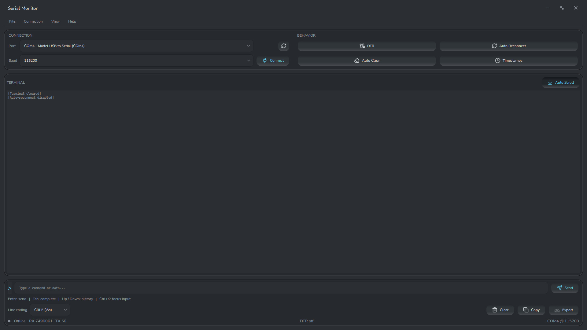

<div align="center">

# 🖥️ Serial Monitor

*A modern, functional Windows serial-port monitor wrapped in an elegant dark **neumorphism (soft-UI)** skin.*

[](https://github.com/baaaaan1/SerMon/releases/latest)


[](https://opensource.org/licenses/MIT)

</div>

The development version is **1.3.0**. See the [changelog](CHANGELOG.md) for the latest changes; published downloads may lag the development branch.

---

## ✨ Features

- 🌗 **Neumorphism dark mode** — soft double shadows and controls painted in code
- 🪟 **Custom frameless title bar** — native dragging, Aero Snap, edge resizing, and minimize/maximize/close controls
- 🖼️ **Dedicated application icon** — displayed as the window/taskbar app icon without cluttering the custom title bar
- Native **menu bar** (`File` / `Connection` / `View` / `Help`) with two-column **Connection / Behavior** controls
- 🧭 **Port + baud** selection and **Refresh ports**
- 🔌 **Connect / Disconnect**, plus a **DTR toggle**
- **Auto Reconnect** retries failed opens and dropped links every ~1 second; **Cancel Retry** stops a pending request
- **Auto Clear** clears old output after each successful connection, including automatic reconnects
- 🖥️ Terminal with colour-coded **RX / TX / system** output and **auto-scroll**
- 🕑 **Timestamps** — optional `[HH:MM:SS.mmm]` prefix on RX/TX lines (`Ctrl+T`)
- 📋 **Copy terminal**, **Export to TXT**, and **Clear** actions
- **Terminal-style TX input** with Up/Down history, draft restoration, and Tab completion from sent commands and received text
- Shared **line-ending mode** for TX and RX parsing: none, LF, CR, or CRLF (default), with chunk-safe newline normalization
- **Saved preferences** restore the last port, baud rate, toggles, line-ending mode, window geometry, and recent command history
- **Bundled Lucide icons from Iconify**, keyboard-accessible controls, and shortcut-aware tooltips
- 📊 Live status — online/offline, RX/TX byte counters, DTR state, and `port @ baud`
- 🔤 **Bundled UI font** — ships **Nunito Sans** with a **Nunito** fallback (SIL OFL) for consistent rendering

## 📥 Requirements

These dependencies are needed when running from source. Packaged Windows x64 builds include Python and the application dependencies.

| Dependency | Version |
|------------|---------|
| Python     | 3.10+   |
| PySide6    | ≥ 6.5   |
| pyserial   | ≥ 3.5   |

## 🚀 Installation

### Windows builds

Download published builds from [GitHub Releases](https://github.com/baaaaan1/SerMon/releases). The v1.3.0 build produces:

| Artifact | Purpose |
|----------|---------|
| `SerialMonitor-v1.3.0.exe` | Standalone application; no Python installation required |
| `SerialMonitor-v1.3.0.msi` | Windows x64 installer; requires administrator approval |

The MSI installs under `%ProgramFiles%\Serial Monitor`, creates Start Menu and desktop shortcuts, upgrades older MSI installations, and blocks downgrades. Standalone and installed copies use the same per-user settings. Uninstalling the MSI does not remove those application-created settings.

The v1.3.0 validation builds are **unsigned**, so Windows may show an unknown-publisher or SmartScreen warning. See the [Windows packaging guide](installer/README.md) for versioning, validation, and signing notes.

### From source

```powershell
git clone https://github.com/baaaaan1/SerMon.git
cd SerMon
python -m venv .venv
.\.venv\Scripts\Activate.ps1
python -m pip install -r requirements.txt
```

## 🏃 Usage

```powershell
python main.py
```

Use the **Connection / Behavior** panel and the command area below the terminal:

1. Pick a **port** (for example, `COM9`) and a **baud rate**.
2. Press **Connect**.
3. Use the **DTR** button to toggle the DTR line.
4. Toggle **Timestamps** (or press <kbd>Ctrl+T</kbd>) to prefix new RX/TX records with a timestamp.
5. Choose the shared **Line ending** mode. It appends the matching TX suffix and parses RX records across serial chunk boundaries.
6. Type in the **TX input** and send with the **Send** button or <kbd>Enter</kbd>.

### Connection behavior

Enable **Auto Reconnect**, then press **Connect** to retry failed opens or lost links approximately once per second. While opening or retrying, the connection action becomes **Cancel Retry** and the port/baud selectors are locked. **Disconnect** or **Cancel Retry** cancels the request, including an open attempt still in progress; pressing **Connect** starts a new request.

Turning Auto Reconnect off stops queued retries without disconnecting a live link or canceling the first explicit open attempt. Turning it back on can resume a previous failed or lost request unless that request was explicitly canceled. Restoring the saved toggle on launch never opens a port automatically.

**Auto Clear** clears terminal output after every successful connection, including automatic reconnects, before the new connected message is displayed. RX/TX counters restart on each successful connection. Changing **DTR** may reset some connected boards.

### Command input

Use <kbd>Up</kbd>/<kbd>Down</kbd> to recall successfully sent commands. Returning past the newest command restores the unsent draft. <kbd>Tab</kbd> accepts a suggested command or received-text token, <kbd>Ctrl+Space</kbd> opens suggestions, and <kbd>Esc</kbd> dismisses them. Unmodified <kbd>Enter</kbd> sends the typed text; it never silently accepts a suggestion. <kbd>Ctrl+Enter</kbd> controls the connection instead.

Input is limited to 4,096 characters. Failed or partial sends retain the input and do not add it to history. History keeps the latest 200 commands, skips blank entries and consecutive duplicates, and supports case-insensitive completion alongside received-text suggestions.

### Terminal behavior

Scrolling away from the bottom pauses **Auto Scroll**. Return to the bottom or enable Auto Scroll to resume following incoming output. Appending output preserves the text selection and, while following is paused, the scroll position. The menu action and terminal-header toggle stay synchronized.

**Clear** removes terminal output, not command history. **Copy** copies all output; <kbd>Ctrl+C</kbd> copies only the selection. **Export** writes UTF-8 text with LF newlines.

### Saved preferences

Settings are saved automatically to Qt's per-user configuration directory (`%APPDATA%\SerMon\SerialMonitor.ini` on Windows). They include the port, baud rate, DTR/reconnect options, terminal toggles, line-ending mode, window geometry, and command history. An unavailable saved port remains selected instead of silently switching devices. Launching restores preferences but does not open a connection automatically.

Command history is stored in **plain text**; do not treat it as a secure place for sensitive commands. Received-text suggestions are kept only in memory. **View > Clear Command History** removes saved commands and completion memory without changing the unsent input. To reset all preferences, close the application before removing its INI file; this also removes saved history.

### Line-ending modes

The footer selector controls both the bytes appended to transmitted text and the delimiter used to parse received records. RX parsing preserves partial UTF-8 characters and delimiters that arrive across separate serial chunks.

| Mode | TX suffix | RX delimiter |
|------|-----------|--------------|
| No line ending | None | Stream text immediately |
| LF | `\n` | `\n` |
| CR | `\r` | `\r` |
| CRLF (default) | `\r\n` | Exact `\r\n` sequence |

Display text normalizes CR, LF, and CRLF to a single visual newline, including CRLF split between serial chunks. TX suffixes remain exactly as selected, and exported UTF-8 text uses LF newlines.

## ⌨️ Keyboard shortcuts

| Action               | Shortcut               |
|----------------------|------------------------|
| Connect / Disconnect | <kbd>Ctrl+Enter</kbd>   |
| Refresh ports        | <kbd>F5</kbd>           |
| Timestamps           | <kbd>Ctrl+T</kbd>       |
| Export to TXT        | <kbd>Ctrl+E</kbd>       |
| Copy terminal        | <kbd>Ctrl+Shift+C</kbd> |
| Clear terminal       | <kbd>Ctrl+L</kbd>       |
| Clear command history | <kbd>Ctrl+Shift+Delete</kbd> |
| Focus command input  | <kbd>Ctrl+K</kbd>       |
| Auto Reconnect       | <kbd>Ctrl+R</kbd>       |
| Auto Clear           | <kbd>Ctrl+Shift+L</kbd> |
| DTR                  | <kbd>Ctrl+D</kbd>       |
| Auto Scroll          | <kbd>Ctrl+Shift+S</kbd> |
| Port / baud / ending | <kbd>Alt+P</kbd> / <kbd>Alt+B</kbd> / <kbd>Alt+E</kbd> |
| Keyboard help        | <kbd>Ctrl+/</kbd>       |
| About                | <kbd>F1</kbd>           |
| Quit                 | <kbd>Ctrl+Q</kbd>       |

<kbd>Ctrl+C</kbd> retains normal selection-copy behavior in the terminal and command input. <kbd>Ctrl+Shift+C</kbd> copies all terminal output regardless of focus. All shortcuts are also listed under **Help > Keyboard Shortcuts**.

## 🖼️ Screenshot



## 📁 Project layout

```text
main.py          Main window, menus, toolbars, status display, and signal wiring
line_endings.py  Shared TX suffix definitions and incremental RX text parser
frameless.py     Custom title bar, window controls, native drag, and resize support
serial_engine.py Threaded serial manager and automatic reconnect handling
widgets.py       Painted controls, terminal output, and command history/completion
icons.py         Offline, theme-aware Lucide SVGs sourced from Iconify
theme.py         Shared palette, bundled-font loader, and global Qt style sheet
about.py         Frameless neumorphic About panel (metadata, credits, and links)
assets/          Application/UI icons, screenshot, fonts, and third-party notices
requirements.txt Python runtime dependencies
tests/           Serial lifecycle, newline, persistence, keyboard, and widget tests
installer/       WiX MSI definition, EXE version resource, license UI, and packaging guide
CHANGELOG.md     Versioned feature, fix, and packaging notes
```

## Testing

Run the regression suite without serial hardware:

```powershell
.venv\Scripts\python.exe -m unittest discover -s tests -v
```

The suite covers serial open/retry/cancellation races, stale events, line-ending parsing, saved preferences, command history/completion, keyboard actions, and terminal selection/scrolling. It uses fake serial devices and temporary settings/export files; passing it does not replace a real-device check or an installer upgrade/uninstall test.

## 📦 Build a Windows EXE (PyInstaller)

Use a **64-bit Python environment** with the source dependencies installed. Install the build tool and run PyInstaller from the project root:

```powershell
python -m pip install pyinstaller -r requirements.txt
$version = python -c "from about import APP_VERSION; print(APP_VERSION)"
python -m PyInstaller --noconfirm --clean --onefile --windowed --name "SerialMonitor-v$version" --icon "assets/app_icon.ico" --version-file "installer/version_info.txt" --add-data "assets;assets" main.py
```

The executable is written to `dist\SerialMonitor-v1.3.0.exe`. `--add-data` bundles the fonts, application icon, dropdown SVG, and third-party notices. `--version-file` supplies the Windows File/Product Version properties. Keep `about.py` and every version field in `installer/version_info.txt` aligned when changing releases.

### Build the MSI

Install **WiX Toolset v3.14** and build the EXE first. From the project root, with the same Python environment active:

```powershell
$version = python -c "from about import APP_VERSION; print(APP_VERSION)"
New-Item -ItemType Directory -Force -Path "build\installer"
& "C:\Program Files (x86)\WiX Toolset v3.14\bin\candle.exe" -arch x64 "-dVersion=$version" -o "build\installer\SerialMonitor-v$version.wixobj" "installer\SerialMonitor.wxs"
& "C:\Program Files (x86)\WiX Toolset v3.14\bin\light.exe" -ext WixUIExtension -o "dist\SerialMonitor-v$version.msi" "build\installer\SerialMonitor-v$version.wixobj"
```

The installer is written to `dist\SerialMonitor-v1.3.0.msi`. Adjust the WiX installation path if necessary. See the [packaging checklist](installer/README.md#release-checklist) before distributing either artifact.

## 🏷️ Releases

Stable versions and downloadable build artifacts are available on the [GitHub Releases](https://github.com/baaaaan1/SerMon/releases) page.

The [changelog](CHANGELOG.md) describes the prepared v1.3.0 changes. Generated `build/`, `dist/`, and PyInstaller `.spec` files are intentionally ignored by Git; pushing a branch or opening a pull request does not publish the EXE/MSI. Attach validated artifacts to a GitHub Release separately when publishing a release.

## 📄 License

Released under the **MIT License** — see [LICENSE](LICENSE) for the full text.

Bundled fonts use the [SIL Open Font License](assets/fonts/OFL.txt). Lucide/Feather-derived icons use the [ISC and MIT notices](assets/lucide-LICENSE.txt) and are bundled locally; the application does not download icons at runtime.

Copyright (c) 2026 baaaaan1

### 👀 Support My Work

If my projects have been useful to you, you can support my work through <strong><a href="https://tako.id/Baaaaan1">tako.id</a></strong>, a platform for sending tips to creators. Your support helps fund hardware prototypes, components, testing, and future open-source projects.

<p>
  <a href="https://tako.id/Baaaaan1"></a>
</p>

<sub>Scan or click the QR code to support my work at <a href="https://tako.id/Baaaaan1">tako.id/Baaaaan1</a>.</sub>

</div>
